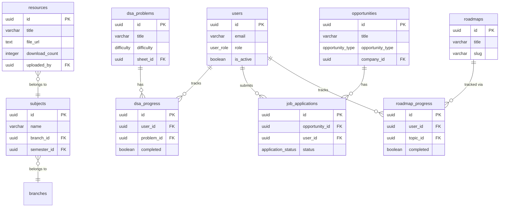

# Database Schema — EngineerPrep India

> **Last updated:** November 2026 | Drizzle ORM 0.45.2 | PostgreSQL 16

## Overview

The database contains **51 tables** organized across 9 functional domains and **14 PostgreSQL enums**.

---

## Enums

| Enum | Values |
|------|--------|
| `user_role` | `STUDENT`, `ADMIN` |
| `resource_type` | `NOTES`, `QUESTION_PAPER`, `SYLLABUS`, `LAB_MANUAL`, `ASSIGNMENT`, `OTHER` |
| `resource_status` | `DRAFT`, `PUBLISHED`, `ARCHIVED` |
| `difficulty` | `EASY`, `MEDIUM`, `HARD`, `BEGINNER`, `INTERMEDIATE`, `ADVANCED` |
| `opportunity_type` | `JOB`, `INTERNSHIP`, `OFF_CAMPUS` |
| `work_mode` | `ONSITE`, `REMOTE`, `HYBRID` |
| `application_status` | `APPLIED`, `UNDER_REVIEW`, `SHORTLISTED`, `INTERVIEW`, `SELECTED`, `REJECTED`, `WITHDRAWN` |
| `notification_type` | `VTU_UPDATE`, `JOB_ALERT`, `INTERNSHIP_ALERT`, `APPLICATION_UPDATE`, `DEADLINE_REMINDER`, `DSA_REMINDER`, `ROADMAP_REMINDER`, `MOCK_TEST_REMINDER`, `WEEKLY_REPORT`, `SYSTEM` |
| `delivery_status` | `PENDING`, `SENT`, `FAILED`, `SKIPPED` |
| `import_status` | `PENDING`, `VALIDATED`, `PROCESSING`, `COMPLETED`, `FAILED` |
| `automation_status` | `ACTIVE`, `DISABLED` |
| `execution_status` | `QUEUED`, `RUNNING`, `SUCCESS`, `FAILED`, `SKIPPED` |
| `bookmark_kind` | `RESOURCE`, `JOB`, `PROBLEM`, `ROADMAP`, `TEST` |
| `test_attempt_status` | `IN_PROGRESS`, `SUBMITTED`, `AUTO_SUBMITTED`, `ABANDONED` |

---

## Domain A — Users & Authentication

### `users`

| Column | Type | Nullable | Default | Notes |
|--------|------|----------|---------|-------|
| `id` | uuid | NOT NULL | `gen_random_uuid()` | PK |
| `email` | varchar(254) | NOT NULL | — | Unique |
| `password_hash` | text | NOT NULL | — | Argon2id or bcrypt |
| `full_name` | varchar(200) | NOT NULL | — | |
| `role` | user_role | NOT NULL | `STUDENT` | |
| `is_active` | boolean | NOT NULL | `true` | |
| `email_verified` | boolean | NOT NULL | `false` | |
| `profile_image_url` | text | NULL | — | |
| `college_name` | varchar(240) | NULL | — | |
| `graduation_year` | integer | NULL | — | |
| `branch` | varchar(100) | NULL | — | Freeform |
| `cgpa` | numeric(3,2) | NULL | — | 0.00–10.00 |
| `bio` | text | NULL | — | |
| `created_at` | timestamptz | NOT NULL | `now()` | |
| `updated_at` | timestamptz | NOT NULL | `now()` | |

**Indexes:** `users_email_idx` (unique), `users_role_idx`, `users_active_idx`

### `refresh_tokens`

| Column | Type | Notes |
|--------|------|-------|
| `id` | uuid PK | |
| `user_id` | uuid FK → users(id) CASCADE | |
| `token_hash` | text NOT NULL | SHA-256 of token |
| `family_id` | uuid NOT NULL | Token family for reuse detection |
| `is_revoked` | boolean NOT NULL DEFAULT false | |
| `expires_at` | timestamptz NOT NULL | |
| `created_at` | timestamptz NOT NULL | |

### `password_reset_tokens`

| Column | Type | Notes |
|--------|------|-------|
| `id` | uuid PK | |
| `user_id` | uuid FK → users(id) CASCADE | |
| `token_hash` | text NOT NULL | SHA-256 of token |
| `expires_at` | timestamptz NOT NULL | 1 hour TTL |
| `used_at` | timestamptz | NULL until consumed |

### `email_verification_tokens`

Similar to `password_reset_tokens` with 24-hour TTL.

### `audit_logs`

| Column | Type | Notes |
|--------|------|-------|
| `id` | uuid PK | |
| `actor_id` | uuid FK → users(id) | Admin who performed action |
| `action` | varchar(80) NOT NULL | e.g. `CREATE`, `DELETE` |
| `entity` | varchar(80) NOT NULL | e.g. `users`, `resources` |
| `entity_id` | uuid | NULL if bulk action |
| `metadata` | jsonb | Additional context |
| `created_at` | timestamptz NOT NULL | |

---

## Domain B — VTU Resources

### `branches` → `semesters` → `schemes` → `subjects` → `resources`

```
branches (code: CSE, ECE, ME...)
  └── subjects (branch_id FK)
        └── resources (subject_id FK)
              └── downloads (resource_id FK)
semesters (number: 1-8)
  └── subjects (semester_id FK)
schemes (year: 2015, 2018, 2022)
  └── subjects (scheme_id FK)
```

**`resources`** key fields: `title`, `resource_type` (enum), `status` (DRAFT/PUBLISHED/ARCHIVED), `file_url`, `download_count`, `uploaded_by` FK → users

**`vtu_updates`**: Announcements from VTU with optional file attachment.

**`downloads`**: Tracks every download event per user per resource. Used for download history and to increment `resources.download_count`.

---

## Domain C — DSA

```
dsa_sheets (Striver SDE Sheet, etc.)
  └── dsa_problems (sheet_id FK, SET NULL on delete)

dsa_patterns (Two Pointers, Sliding Window, etc.)
  └── dsa_problems (pattern_id FK, SET NULL on delete)

dsa_problems
  ├── dsa_solutions (problem_id FK, CASCADE)
  └── dsa_progress (problem_id FK, CASCADE)
        └── UNIQUE(user_id, problem_id)
```

**`dsa_progress`**: The critical student-isolation table. Every row must have both `user_id` AND `problem_id` to prevent cross-user data corruption.

---

## Domain D — Roadmaps

```
roadmaps
  └── roadmap_stages (roadmap_id FK, CASCADE)
        └── roadmap_topics (stage_id FK, CASCADE)
              └── roadmap_progress (topic_id FK, CASCADE)
                    └── UNIQUE(user_id, topic_id)
```

---

## Domain E — Mock Tests

```
mock_tests
  └── questions (test_id FK, CASCADE)
        └── question_options (question_id FK, CASCADE)
              └── test_responses (selected_option_id FK)

test_attempts
  └── test_responses (attempt_id FK, CASCADE)
```

---

## Domain F — Jobs & Applications

```
companies
  └── opportunities (company_id FK, SET NULL)
        └── job_applications (opportunity_id FK, CASCADE)
              └── UNIQUE(opportunity_id, user_id)
        └── saved_opportunities (PK: opportunity_id + user_id)
```

---

## Domain G — Notifications

```
notification_templates → notification_outbox → notifications
                                             └── notification_deliveries
notification_preferences (one per user)
```

---

## Domain H — Automation

```
automation_rules
  └── automation_executions (rule_id FK, CASCADE)
automation_settings (key-value store)
scheduled_tasks
import_jobs
```

---

## ER Diagram (Core Tables)



---

## Key Constraints Summary

| Table | Unique Constraint |
|-------|------------------|
| `users` | `email` |
| `dsa_progress` | `(user_id, problem_id)` |
| `roadmap_progress` | `(user_id, topic_id)` |
| `bookmarks` | `(user_id, kind, reference_id)` |
| `job_applications` | `(opportunity_id, user_id)` |
| `saved_opportunities` | Composite PK |
| `student_streaks` | `user_id` |
| `notification_preferences` | `user_id` |
| `notification_outbox` | `idempotency_key` |
| `automation_rules` | `idempotency_key` |

---

## Cascade Delete Summary

| Parent | Child Table | On Delete |
|--------|-------------|-----------|
| `users` | `refresh_tokens`, `password_reset_tokens`, `email_verification_tokens` | CASCADE |
| `users` | `dsa_progress`, `roadmap_progress`, `job_applications` | CASCADE |
| `users` | `notifications`, `notification_outbox`, `student_streaks`, `learning_activities` | CASCADE |
| `dsa_sheets` | `dsa_problems` | SET NULL |
| `dsa_patterns` | `dsa_problems` | SET NULL |
| `roadmaps` | `roadmap_stages` → `roadmap_topics` → `roadmap_progress` | CASCADE (chain) |
| `mock_tests` | `questions` → `question_options` | CASCADE (chain) |
| `test_attempts` | `test_responses` | CASCADE |
| `opportunities` | `job_applications` | CASCADE |
| `automation_rules` | `automation_executions` | CASCADE |
